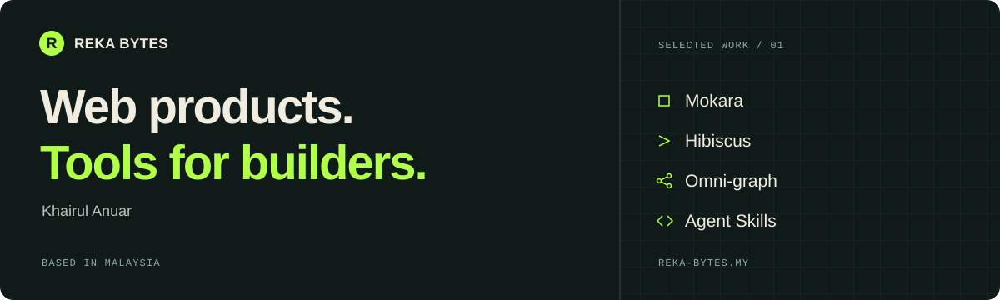
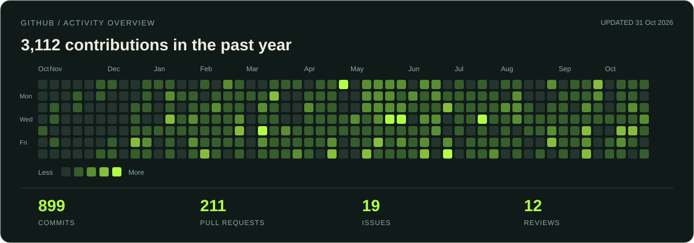

<!-- ACTIVITY: generated daily by .github/workflows/activity.yml -->

# Hi, I'm Khairul.

I'm a developer based in Malaysia, building [Mokara](https://mokara.my) and open-source tools under [Reka Bytes](https://reka-bytes.my).

I work across product design, full-stack TypeScript, and Rust. My projects span team task management, terminal interfaces, and tools that help coding agents keep context between sessions.

[Studio](https://reka-bytes.my) · [Journal](https://reka-bytes.my/journal) · [Threads](https://www.threads.com/@rekabytesmy)

## Selected projects

| Project | What I'm building |
| :--- | :--- |
| [**Mokara**](https://github.com/rekabytes/mokara) | Task management for teams, with shared boards, assignments, and progress tracking. Built with Next.js, Hono, and PostgreSQL. [Try Mokara](https://mokara.my). |
| [**Hibiscus**](https://github.com/Rekabytes-Enterprise/hibiscus) | A Rust terminal interface for the Pi coding agent. Chat, switch models, resume sessions, and attach images without leaving the terminal. |
| [**Omni-graph**](https://github.com/Rekabytes-Enterprise/omni-graph) | Local memory for coding agents. Store decisions and lessons in SQLite, connect them in a graph, and recall the context in later sessions. |
| [**Agent Skills**](https://github.com/Rekabytes-Enterprise/agentSKills) | Portable workflows for planning projects and engineering against the actual stack, with PRDs, phased delivery, and verification. |

## What connects the work

Mokara helps people coordinate work. Hibiscus gives coding agents a terminal interface. Omni-graph preserves project knowledge between sessions. Agent Skills puts a repeatable process around planning and implementation.

I build the tools I want to use, then share the code and what I learn along the way.

---

Have a product in mind? [Start a conversation with Reka Bytes](https://reka-bytes.my/#contact).
